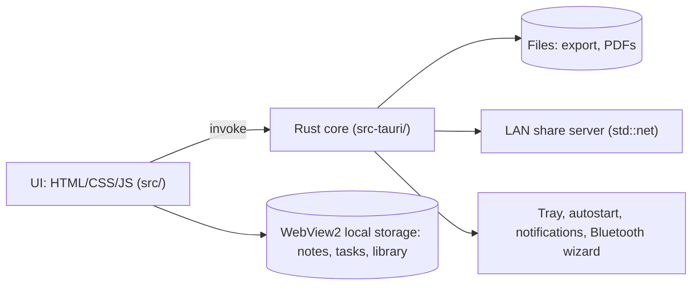

# Notia — system design & workflow

## 1. Goals and constraints
Offline Windows 10/11 note app, lightweight, professional, FR/EN, no Python, no external APIs, no readable source in the shipped product, standard installer, public source repo, mobile version later.

## 2. Architecture

- **Why Tauri 2:** system WebView2 (no bundled browser) gives a ~5–10 MB installer and low RAM, and the UI is embedded in the compiled `.exe`. Electron was rejected as heavy and its `asar` is trivially extractable.
- **Why vanilla JS:** no framework, no runtime dependency except the PDF engine (`pdfjs-dist`, copied to `src/vendor` at build time).
- **Installer:** NSIS, license page, English/French choice, per-user install (no admin rights).

## 3. Modules
| File | Role |
|---|---|
| `src/app.js` | state, categories, notes, editor, code colorizer, tasks, reminders, TXT/MD/DOCX export, themes, i18n |
| `src/extra.js` | PDF library and viewer, month planner, PDF writer, sharing, tutorial, extra editor tools, shortcuts |
| `src-tauri/src/main.rs` | save dialog, file read, LAN server, Bluetooth launcher, tray, autostart, close-to-tray |

## 4. Data model (one JSON document, per-user, offline)
`{lang, theme, tour, cats[{id,name}], notes[{id,cat,title,html,ts}], todos[{id,text,due,done}], lib{secs, books[{id,path,name,page,max,total,secs}]}}`
Autosave on every change. PDFs are never copied: the library stores their path, last page, furthest page (`max`, used for percent read), and seconds read (counted only while the viewer is open and the window focused). 10 books max.

## 5. Key decisions
- **Reminders** run in a 15 s timer; closing the window hides it to the tray and the optional "Start with Windows" setting keeps reminders alive after reboot. Quit from the tray menu.
- **Sharing without APIs:** Wi-Fi = a temporary HTTP server on a random port with a random token, serving only the shared file; Bluetooth = Windows' built-in `fsquirt` wizard; Telegram/WhatsApp/email = share URLs and `mailto:`; Drive = save the file, open Drive in the browser.
- **PDF export** is a built-in text-only writer (Latin-1). For images or exact styling use Print, then "Microsoft Print to PDF".
- **Security:** strict CSP, no remote scripts, the share server stops when its dialog closes, and nothing leaves the PC unless the user shares it.

## 6. Build workflow
1. `npm install` 2. `npm run vendor` (PDF engine) 3. `npm run icons` (from `src/icon.svg`) 4. `npm run build` → `src-tauri/target/release/bundle/nsis/*.exe`.
CI does all four on `windows-latest` (`.github/workflows/build.yml`, run manually or push a `v*` tag).

## 7. Test checklist
Install on Windows 10 and 11; create/delete categories; paste code and images; export all formats and open them in Word/Reader; reminder with window hidden; Wi-Fi share from a phone; Bluetooth wizard; add 10 PDFs, close and reopen to check page/percent/time; FR/EN and dark/light.

## 8. Roadmap
Full-fidelity PDF export, QR code for Wi-Fi share, SQLite storage and sync format for the mobile app, note encryption, backup/restore, PDF text search.
